# Práctica: Configuración y conectividad de motores de bases de datos en red

**Servidor (IP):** 192.168.0.26
**Cliente:** Linux Mint (Máquina Virtual)

---

## Estado del servidor
Antes de hacer nada con los clientes, he comprobado que los tres motores de bases de datos están activos en el servidor (PostgreSQL y MariaDB como servicios de `systemd`, y Oracle metido en un contenedor de `podman`).
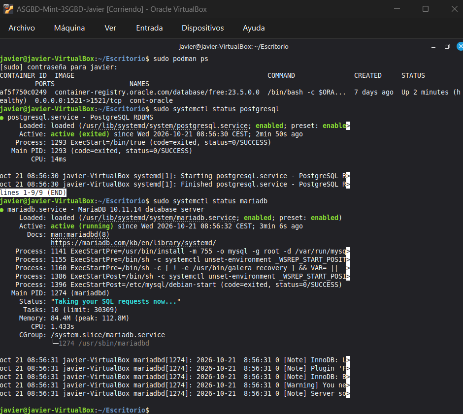

---

## 1. PostgreSQL

### 1.1. Conexión por terminal
Después de configurar el servidor para que acepte conexiones remotas, he instalado el paquete `postgresql-client` en mi cliente de Linux Mint para poder entrar por terminal.
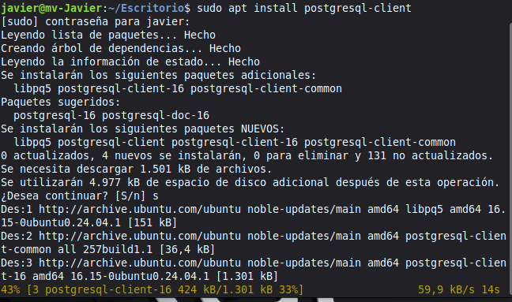

Me he conectado en remoto usando el comando `psql -h 192.168.0.26 -U pguser -d dbpg -W`.

### 1.2. Conexión gráfica (pgAdmin 4)
Me he descargado e instalado la versión de escritorio de pgAdmin 4. Luego he añadido el servidor remoto apuntando a la base de datos `dbpg` y ha conectado a la primera, mostrando el panel de rendimiento.
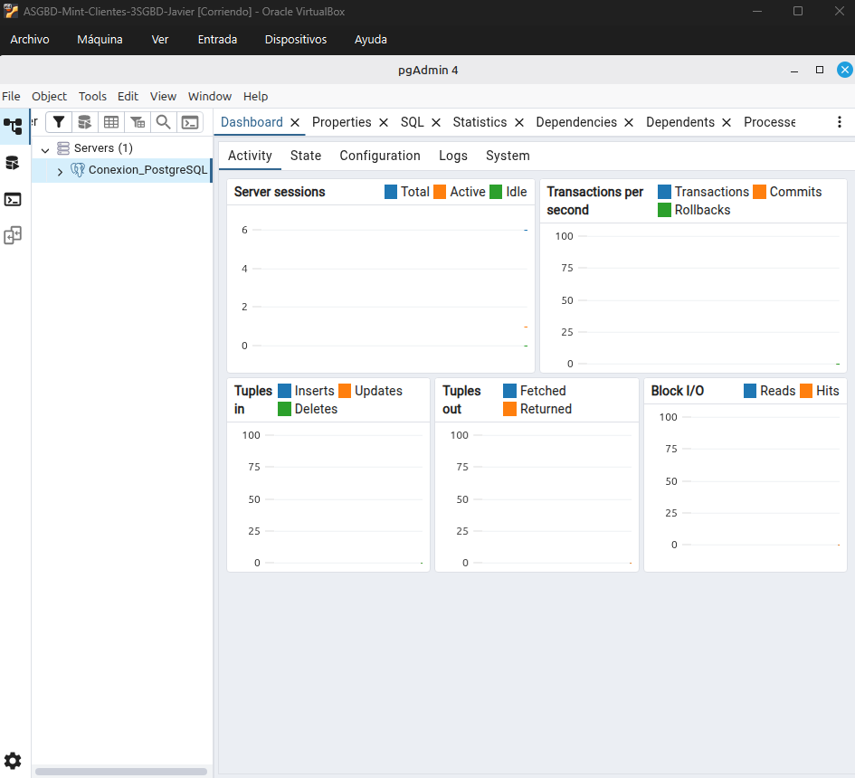

---

## 2. MariaDB

### 2.1. Conexión por terminal (mariadb-client)
Una vez ajustados los permisos de red en el servidor, me he conectado por consola desde el cliente con el comando `mariadb -h 192.168.0.26 -u muser -p dbm`. Ha entrado perfecto al monitor de MariaDB.
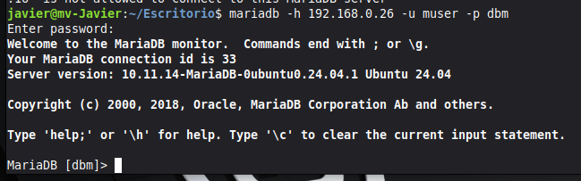

### 2.2. Conexión web (phpMyAdmin)
He montado Apache y phpMyAdmin en el cliente. Para que no busque en local, he tocado el archivo `config.inc.php` para meter la IP del servidor remoto. Al entrar desde el navegador, conecta bien y me carga la base de datos `dbm`.
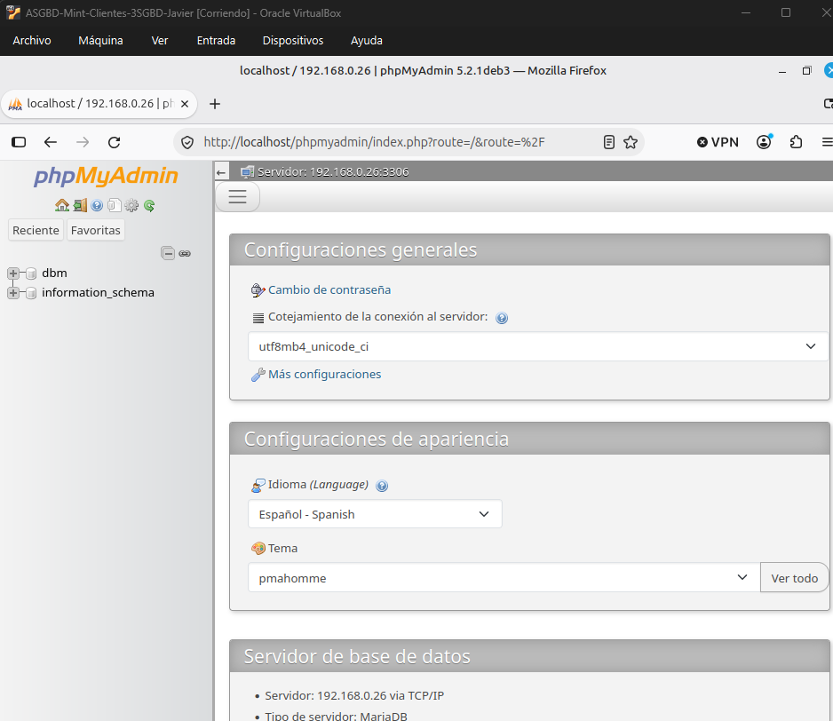

---

## 3. Oracle Database

### 3.1. Conexión con Oracle SQL Developer
Primero he tenido que instalar Java (JDK) y `unzip` porque hacían falta. 
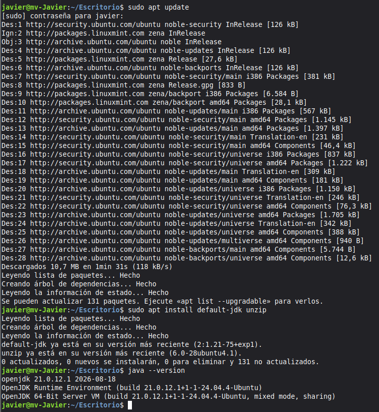

Después me he descargado el `.zip` oficial de Oracle (la versión sin JRE) y lo he descomprimido en `/opt/`.
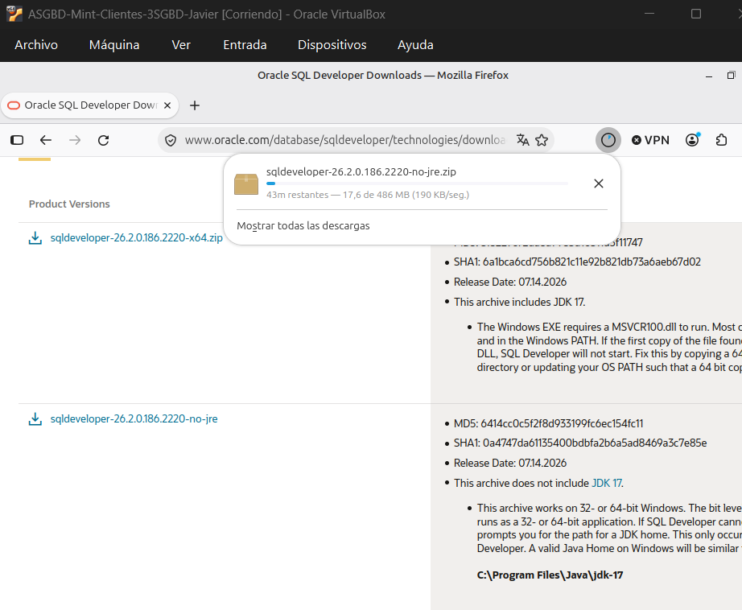
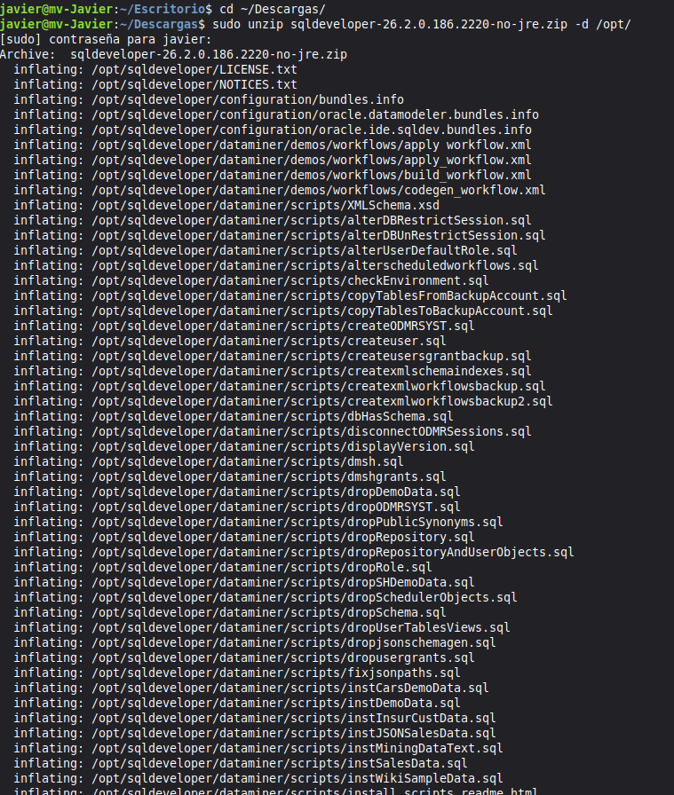

Para arrancarlo, he ejecutado su script y ya me ha salido la pantalla de carga y la de bienvenida.
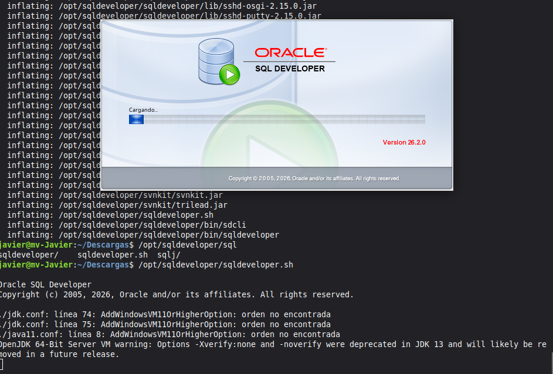
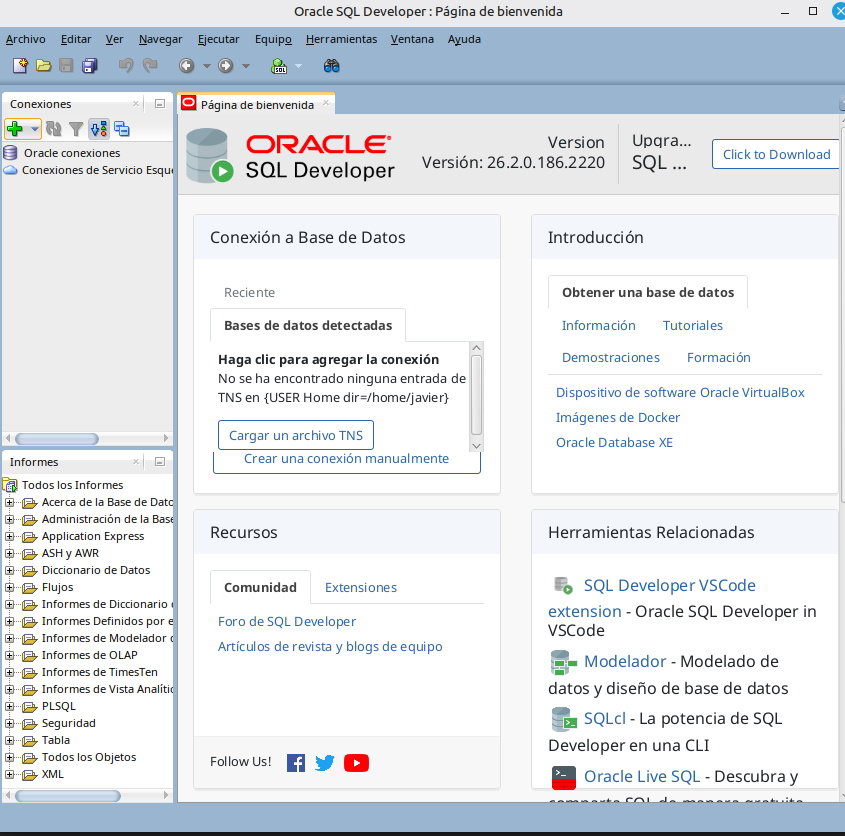

He creado un acceso directo (`.desktop`) para tenerlo integrado en el menú de aplicaciones. Por último, he creado la conexión usando el usuario `orauser` y el servicio `FREEPDB1`.
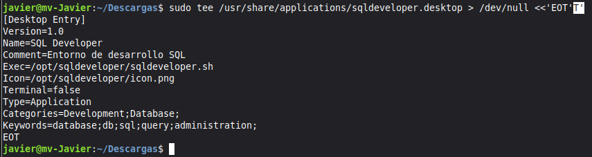
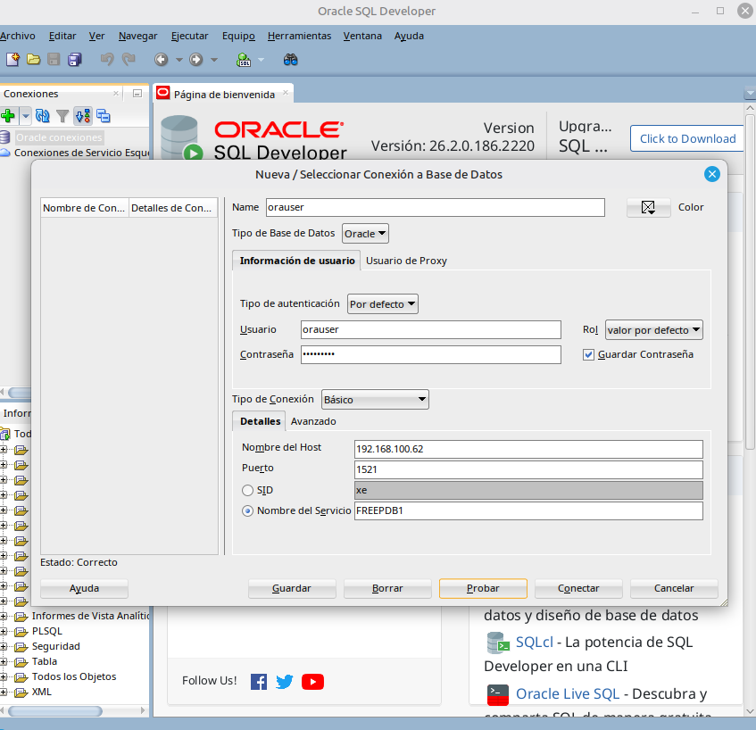

### 3.2. Conexión con Visual Studio Code
Para probar otra opción, también he configurado Visual Studio Code.
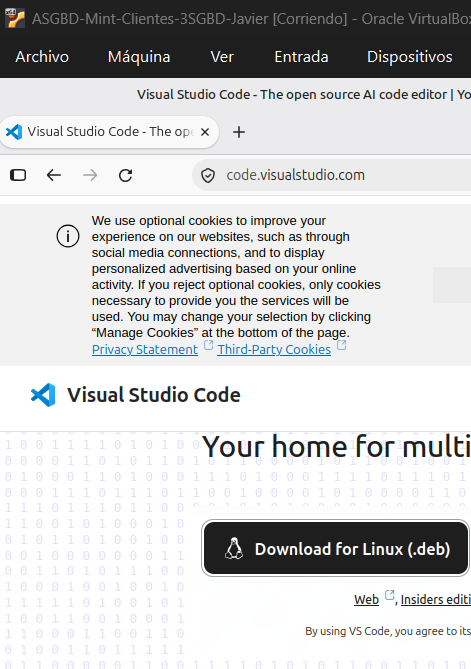
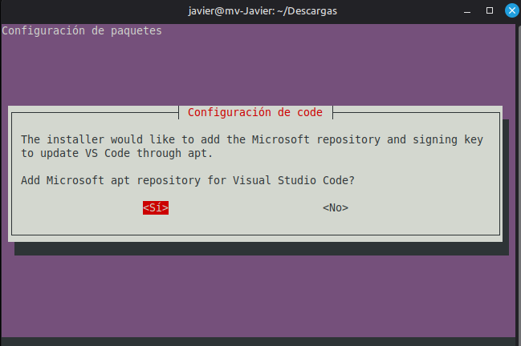

Luego he buscado la extensión oficial "Oracle SQL Developer for VS Code" y la he instalado.
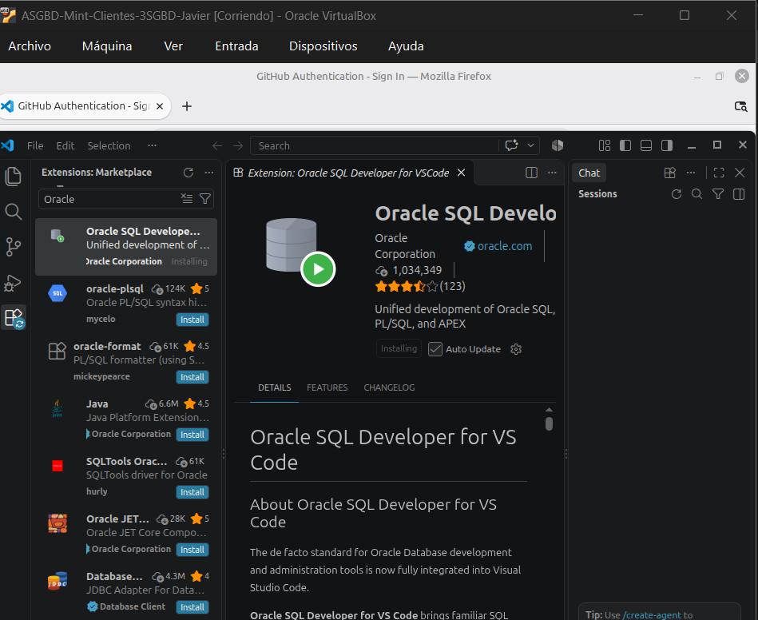

Desde la propia extensión, he montado la conexión al servicio `FREEPDB1` de la IP `192.168.0.26`.
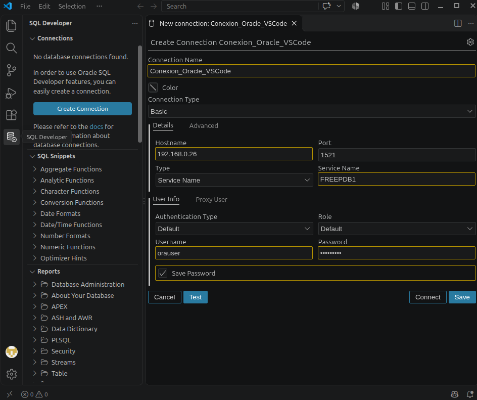

---

## 4. Clientes Multi-SGBD: DBeaver Community

Para terminar, he instalado el `.deb` de DBeaver Community en el cliente. Con este programa he podido juntarlo todo: he configurado las tres conexiones para conectarme a la vez a:

1. **PostgreSQL:** Conexión a `dbpg` con el usuario `pguser`.
2. **MariaDB:** Conexión a `dbm` con el usuario `muser`.
3. **Oracle Database:** Conexión al servicio `FREEPDB1` por el puerto `1521` con el usuario `orauser`.

En esta última captura se puede ver que están las tres bases de datos conectadas y listas en el mismo panel de la izquierda.
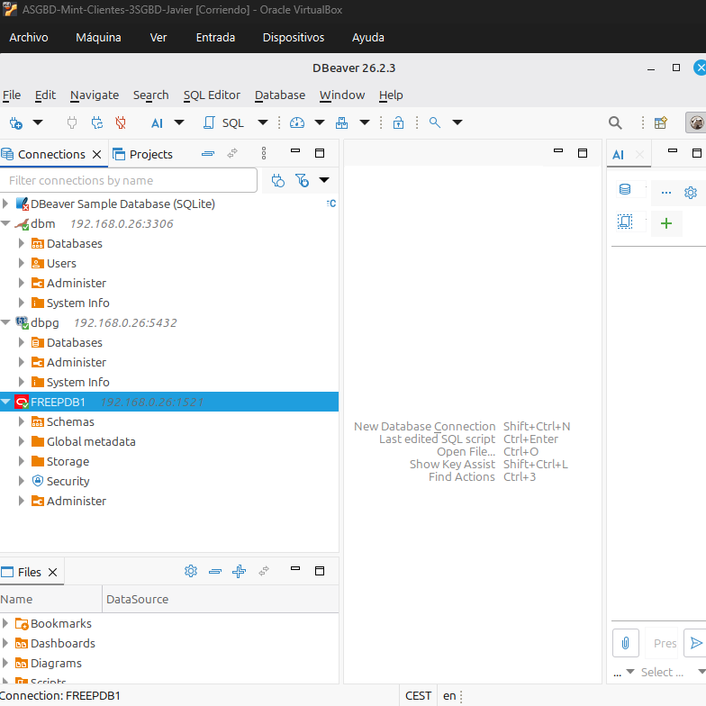
